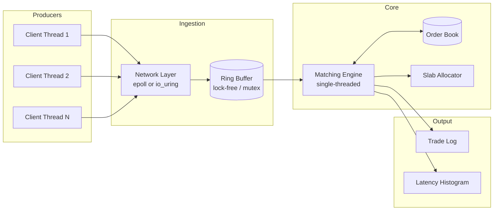

# Team Lead Plan: Concurrent Low-Latency Order Matching Engine

This is your map. It assumes zero prior exposure to this specific domain and takes you all the way from an empty repo to a benchmarked system — what to type first, what each piece looks like in code, and where to learn what you don't know yet.

**Language:** modern C++ (C++17/20). Use RAII and templates freely — they cost nothing at runtime. Be deliberate about avoiding exceptions and `std::shared_ptr` in the matching engine's hot path — both have latency costs that work against the entire point of this project.

---

## 0. Before Anyone Writes Logic: Repo & Build Setup

Do this on day 1, before any component work starts, so everyone builds against the same skeleton.

**Folder structure:**
```
matching-engine/
├── CMakeLists.txt
├── include/
│   ├── order.hpp
│   ├── order_book.hpp
│   ├── ring_buffer.hpp
│   ├── slab_allocator.hpp
│   ├── network_layer.hpp
│   └── benchmark.hpp
├── src/
│   ├── order_book.cpp
│   ├── ring_buffer.cpp
│   ├── slab_allocator.cpp
│   ├── network_epoll.cpp
│   ├── network_io_uring.cpp
│   └── main.cpp
├── tests/
│   ├── test_order_book.cpp
│   ├── test_ring_buffer.cpp
│   └── test_slab_allocator.cpp
└── bench/
    └── bench_main.cpp
```

**Minimal `CMakeLists.txt` to start with:**
```cmake
cmake_minimum_required(VERSION 3.16)
project(matching_engine CXX)

set(CMAKE_CXX_STANDARD 20)
set(CMAKE_CXX_STANDARD_REQUIRED ON)

# Sanitizer build type — use this constantly during development
option(ENABLE_SANITIZERS "Build with ASan/TSan" OFF)
if(ENABLE_SANITIZERS)
    add_compile_options(-fsanitize=address,undefined -g -O0)
    add_link_options(-fsanitize=address,undefined)
endif()

add_executable(matching_engine src/main.cpp src/order_book.cpp src/ring_buffer.cpp src/slab_allocator.cpp)
target_include_directories(matching_engine PRIVATE include)
target_link_libraries(matching_engine PRIVATE pthread)
```
Build with sanitizers on by default during development:
```
mkdir build && cd build
cmake -DENABLE_SANITIZERS=ON ..
make
```
Note: ASan and TSan cannot be combined in one build (they conflict) — build twice, once with `-fsanitize=address,undefined` for memory bugs, once with `-fsanitize=thread` for the ring buffer's concurrency correctness.

**Git workflow:** one branch per component (`feature/ring-buffer`, `feature/slab-allocator`, etc.), merge into `main` at the end of every week minimum — don't let branches diverge for a month. Whoever owns the order book (A) merges first each week since everyone else builds against it.

---

## 1. Big Picture Architecture



**The one design decision that makes this tractable:** the matching engine is single-threaded — only one thread ever touches the order book. All concurrency complexity lives at the boundary (the ring buffer), not inside the matching logic. Don't let anyone propose a multi-threaded order book — that's a research problem, not a 2-month build.

---

## 2. Core Data Types (write these first, everyone depends on them)

`include/order.hpp`:
```cpp
#pragma once
#include <cstdint>
#include <chrono>

enum class Side : uint8_t { Buy, Sell };

struct Order {
    uint64_t id;
    Side side;
    double price;
    uint32_t quantity;
    std::chrono::steady_clock::time_point submit_time; // for latency measurement
};

struct Trade {
    uint64_t buy_order_id;
    uint64_t sell_order_id;
    double price;
    uint32_t quantity;
};
```
`submit_time` is critical — it's what lets the benchmarking harness (§6) compute end-to-end latency later. Stamp it the moment an order is created, not when it reaches the matching engine.

---

## 3. Component 1: Order Book + Matching Engine (Owner: A)

**Algorithm (price-time priority):**
1. New order arrives.
2. If it's a **buy**, check the lowest-priced **sell** in the book. If `buy.price >= best_sell.price`, they match — trade at `best_sell.price`, for `min(buy.quantity, best_sell.quantity)`.
3. Repeat while the incoming order still has quantity left and can still cross.
4. If quantity remains and no more matches are possible, insert the remainder into the book at its price level, at the back of that level's queue (time priority).
5. Mirror logic for **sell** orders against the buy side.

**Code skeleton:**
```cpp
#pragma once
#include "order.hpp"
#include <map>
#include <deque>
#include <vector>
#include <optional>

class OrderBook {
public:
    // Returns any trades generated. No exceptions — empty vector means "resting, no match".
    std::vector<Trade> submit(Order order);

private:
    // Buys: highest price first -> use std::greater
    std::map<double, std::deque<Order>, std::greater<double>> buy_levels_;
    // Sells: lowest price first -> default less
    std::map<double, std::deque<Order>> sell_levels_;
};
```
```cpp
// order_book.cpp
std::vector<Trade> OrderBook::submit(Order order) {
    std::vector<Trade> trades;
    if (order.side == Side::Buy) {
        while (order.quantity > 0 && !sell_levels_.empty()) {
            auto& [best_price, level] = *sell_levels_.begin();
            if (order.price < best_price) break; // no cross possible
            Order& resting = level.front();
            uint32_t fill_qty = std::min(order.quantity, resting.quantity);
            trades.push_back({order.id, resting.id, best_price, fill_qty});
            order.quantity -= fill_qty;
            resting.quantity -= fill_qty;
            if (resting.quantity == 0) {
                level.pop_front();
                if (level.empty()) sell_levels_.erase(sell_levels_.begin());
            }
        }
        if (order.quantity > 0) buy_levels_[order.price].push_back(order);
    } else {
        // mirror image for sell orders — implement symmetrically
    }
    return trades;
}
```

**Test cases to write before anyone depends on this (this is your "definition of done"):**
1. Single buy order, empty book → rests in book, no trades.
2. Buy crosses one resting sell exactly (equal quantity) → one trade, book empty after.
3. Buy partially fills a larger resting sell → one trade, remainder still resting.
4. Buy fills across multiple price levels → multiple trades, correct price-time order.
5. Two resting orders at the same price → first-in is filled first (time priority check).
6. Order with no possible match → rests correctly, doesn't crash on empty book.

**Learn from:** search "limit order book price-time priority" for the standard exchange-matching model — several accessible explainer articles exist.

---

## 4. Component 2: Ring Buffer (Owner: B)

**Build order:** mutex version first (correctness baseline), then SPSC lock-free.

**Mutex version:**
```cpp
template<typename T, size_t Capacity>
class MutexRingBuffer {
public:
    bool push(const T& item) {
        std::lock_guard<std::mutex> lock(mutex_);
        if (count_ == Capacity) return false; // full
        buffer_[tail_] = item;
        tail_ = (tail_ + 1) % Capacity;
        ++count_;
        return true;
    }
    std::optional<T> pop() {
        std::lock_guard<std::mutex> lock(mutex_);
        if (count_ == 0) return std::nullopt;
        T item = buffer_[head_];
        head_ = (head_ + 1) % Capacity;
        --count_;
        return item;
    }
private:
    std::array<T, Capacity> buffer_;
    size_t head_ = 0, tail_ = 0, count_ = 0;
    std::mutex mutex_;
};
```

**Lock-free SPSC version — the core idea:** one atomic index for the producer (tail), one for the consumer (head), each thread only ever writes its own index and reads the other's.
```cpp
template<typename T, size_t Capacity>
class SPSCRingBuffer {
public:
    bool push(const T& item) {
        size_t tail = tail_.load(std::memory_order_relaxed);
        size_t next = (tail + 1) % Capacity;
        if (next == head_.load(std::memory_order_acquire)) return false; // full
        buffer_[tail] = item;
        tail_.store(next, std::memory_order_release);
        return true;
    }
    std::optional<T> pop() {
        size_t head = head_.load(std::memory_order_relaxed);
        if (head == tail_.load(std::memory_order_acquire)) return std::nullopt; // empty
        T item = buffer_[head];
        head_.store((head + 1) % Capacity, std::memory_order_release);
        return item;
    }
private:
    std::array<T, Capacity> buffer_;
    // alignas prevents false sharing — head_ and tail_ on separate cache lines
    alignas(64) std::atomic<size_t> head_{0};
    alignas(64) std::atomic<size_t> tail_{0};
};
```
**Why `memory_order_release`/`acquire` and not just `seq_cst`:** release-acquire is enough to guarantee the consumer sees the fully-written item before it sees the updated index — that's the only ordering guarantee you actually need, and it's cheaper than full sequential consistency. This is worth understanding deeply, not copying blindly — read the resource below before touching this file.

**Definition of done:** run both versions under a stress test (many pushes/pops for 60+ seconds) with `-fsanitize=thread` — zero reported races, and a checksum/counter proving no order was lost or duplicated.

**Learn from:**
- `cppreference.com/w/cpp/atomic/memory_order` — keep this open while writing this file.
- Search "LMAX Disruptor architecture" — the canonical real-world reference for exactly this pattern.
- Paul McKenney's *"Is Parallel Programming Hard, And, If So, What Can You Do About It?"* (free online) — the memory-ordering chapter specifically.

---

## 5. Component 3: Slab Allocator (Owner: C)

**Algorithm:** pre-allocate one large block sized for N `Order`s. Maintain a free list — a simple linked list threaded through the unused slots themselves (no extra memory needed for bookkeeping).
```cpp
template<typename T, size_t PoolSize>
class SlabAllocator {
public:
    SlabAllocator() {
        for (size_t i = 0; i < PoolSize - 1; ++i)
            *reinterpret_cast<void**>(&pool_[i]) = &pool_[i + 1];
        *reinterpret_cast<void**>(&pool_[PoolSize - 1]) = nullptr;
        free_list_ = &pool_[0];
    }
    T* allocate() {
        if (!free_list_) return nullptr; // pool exhausted
        T* slot = reinterpret_cast<T*>(free_list_);
        free_list_ = *reinterpret_cast<void**>(free_list_);
        return slot;
    }
    void deallocate(T* ptr) {
        *reinterpret_cast<void**>(ptr) = free_list_;
        free_list_ = ptr;
    }
private:
    alignas(T) std::array<std::byte, sizeof(T) * PoolSize> pool_;
    void* free_list_;
};
```
**Definition of done:** benchmark `allocate()`/`deallocate()` against `new`/`delete` under the same load — you should see both lower average latency and lower variance (this is the number that matters more than the average).

**Stretch goal (genuinely advanced, only if time allows):** wrap this to satisfy the `std::allocator` interface so `std::vector<Order, SlabAllocator<Order>>` works — teaches a rarely-understood corner of the STL.

**Learn from:**
- OSTEP (*Operating Systems: Three Easy Pieces*, free online) — memory management chapters for the conceptual background (fragmentation, free lists).
- Search "slab allocator explained" (originated in Solaris kernel, well documented).

---

## 6. Component 4: Scheduling Experiments (Owner: D)

**CPU affinity:**
```cpp
#include <pthread.h>
void pin_to_core(std::thread& t, int core_id) {
    cpu_set_t cpuset;
    CPU_ZERO(&cpuset);
    CPU_SET(core_id, &cpuset);
    pthread_setaffinity_np(t.native_handle(), sizeof(cpu_set_t), &cpuset);
}
```
**Real-time scheduling policy:**
```cpp
#include <pthread.h>
void set_realtime(std::thread& t, int priority = 80) {
    sched_param sch{};
    sch.sched_priority = priority;
    // Needs CAP_SYS_NICE or root — sort this out on your test machine in week 1, not week 7
    pthread_setschedparam(t.native_handle(), SCHED_FIFO, &sch);
}
```
**Definition of done:** run the full benchmark (§6 below) under three configurations — default scheduling, CPU-pinned only, CPU-pinned + `SCHED_FIFO` — and produce three latency histograms with a written explanation of what changed at the tail (p99/p999) versus the average.

**Learn from:** `man 7 sched` on any Linux machine — short, precise, authoritative. Search "Linux real-time scheduling SCHED_FIFO example" for a runnable pattern.

---

## 7. Component 5: Network Ingestion + Benchmarking Harness (Owner: E — the backbone of your results)

**epoll skeleton (baseline):**
```cpp
int epfd = epoll_create1(0);
epoll_event ev{};
ev.events = EPOLLIN;
ev.data.fd = listen_fd;
epoll_ctl(epfd, EPOLL_CTL_ADD, listen_fd, &ev);

epoll_event events[64];
while (running) {
    int n = epoll_wait(epfd, events, 64, -1);
    for (int i = 0; i < n; ++i) {
        // read order bytes from events[i].data.fd, parse, push to ring buffer
    }
}
```

**io_uring skeleton (using liburing — `apt install liburing-dev` or build from source):**
```cpp
#include <liburing.h>
io_uring ring;
io_uring_queue_init(256, &ring, 0);

io_uring_sqe* sqe = io_uring_get_sqe(&ring);
io_uring_prep_read(sqe, client_fd, buffer, buf_size, 0);
io_uring_submit(&ring);

io_uring_cqe* cqe;
io_uring_wait_cqe(&ring, &cqe);
// process bytes read (cqe->res), parse order, push to ring buffer
io_uring_cqe_seen(&ring, cqe);
```
The core difference to actually understand and write up: `epoll_wait` tells you a socket is *ready*, then you still call `read()` yourself (two syscalls per event). `io_uring` lets you submit the read itself and get notified on completion, batched, through shared memory rings — fewer syscalls under load. This is the whole point of the comparison; make sure your benchmark isolates syscall count/CPU time, not just wall-clock.

**Benchmarking harness — the tool everyone else's results depend on:**
```cpp
struct LatencySample { uint64_t nanos; };

class LatencyRecorder {
public:
    void record(std::chrono::steady_clock::time_point start) {
        auto end = std::chrono::steady_clock::now();
        auto ns = std::chrono::duration_cast<std::chrono::nanoseconds>(end - start).count();
        samples_.push_back(ns);
    }
    void report() {
        std::sort(samples_.begin(), samples_.end());
        auto pct = [&](double p) { return samples_[size_t(p * samples_.size())]; };
        std::cout << "p50: " << pct(0.50) << "ns  "
                  << "p99: " << pct(0.99) << "ns  "
                  << "p999: " << pct(0.999) << "ns\n";
    }
private:
    std::vector<uint64_t> samples_;
};
```
Record `submit_time` (from `Order`, §2) to trade-generation time for every order — that's your true end-to-end latency, not just a sub-component's internal timing.

**Definition of done:** a single harness runnable against any configuration (mutex/lock-free queue × default/RT scheduling × epoll/io_uring) producing p50/p99/p999 — every "before vs after" comparison in your final report comes from this one tool, so all numbers are comparable.

**Learn from:** **"Lord of the io_uring"** by Shuveb Hussain (free online guide, written specifically to take you from zero on this API) — the single best resource for this component. `man epoll` for the baseline. Search "HdrHistogram" for a more precise percentile-tracking technique than naive sorting, if you want to go further.

---

## 8. Week-by-Week Roadmap

| Week | Goal | Risk to watch |
|---|---|---|
| 1 | Repo/build setup (§0). A builds order book + matching logic + all 6 test cases (§3). Everyone else reads their §4–7 resources and writes a throwaway naive prototype. | Don't let anyone start "optimized" versions before naive baselines exist. |
| 2 | A merges tested core to `main` — treat as hard gate. B/C/D/E finish naive baselines against a stub interface. | If core isn't merged and stable by end of week 2, everything downstream slips. |
| 3–4 | B builds SPSC lock-free queue, C builds slab allocator, D sets up affinity/RT scheduling, E builds io_uring layer — all in parallel against the stable core. | Lock-free bugs (B) are the highest-risk item in the whole project — budget real debugging time. |
| 5 | First integration: wire everything into one running binary (`main.cpp`). | Integration always takes longer than expected — don't schedule anything else this week. |
| 6 | Fix integration issues. Run E's harness across every config combo (mutex/lock-free × default/RT × epoll/io_uring — 8 combos total). | Keep a spreadsheet of tested combos — easy to think you tested something and hadn't. |
| 7 | Analyze results — for every surprising number, dig into *why* using `perf`. | Don't skip the "why" — an unexplained chart is worth far less than two correct sentences of reasoning. |
| 8 | Write-up, cleanup, demo prep. | Buffer week — absorbs any slippage. |

---

## 9. Master Definition-of-Done Checklist

- [ ] Order book passes all 6 test cases (§3)
- [ ] Mutex ring buffer stress-tested, no data loss
- [ ] SPSC lock-free ring buffer passes TSan clean under sustained concurrent load
- [ ] Slab allocator benchmarked against `new`/`delete`, variance measured not just average
- [ ] Scheduling experiments run under 3 configs, tail latency (p99/p999) compared
- [ ] epoll and io_uring both functional, syscall counts compared (`perf stat -e raw_syscalls:sys_enter`)
- [ ] Full integrated system runs end-to-end under all 8 config combinations
- [ ] Every result has a written explanation, not just a number

---

## 10. Risk Register

| Risk | Mitigation |
|---|---|
| Lock-free queue has subtle bugs | SPSC only; TSan from day one; don't attempt MPSC without slack time |
| io_uring learning curve steeper than expected | epoll is a guaranteed-working fallback so the comparison still happens |
| Integration week runs long | Two buffer weeks (6, 8) scheduled after it on purpose |
| One member's work blocks others | Order book (A) is a hard gate at week 2 — escalate early if slipping |
| `SCHED_FIFO` permission issues discovered late | Confirm `CAP_SYS_NICE`/root access on the test machine in week 1 |

---

## 11. What "Immense Value" Actually Looks Like at the End

Not a working demo alone — latency graphs you can explain cold, under questioning: why the lock-free queue wins at high contention but not low contention, why real-time scheduling reduces tail latency but not average latency, why io_uring's advantage grows with connection count. That explanatory fluency is the real deliverable.
