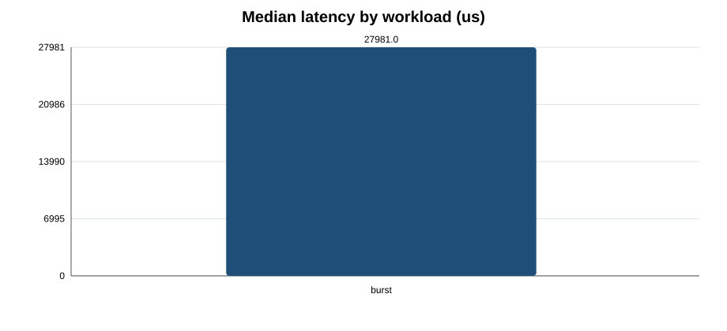
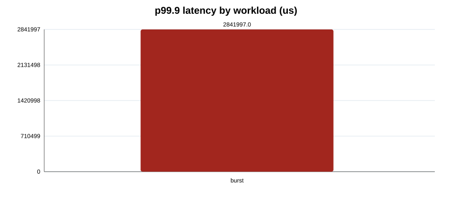
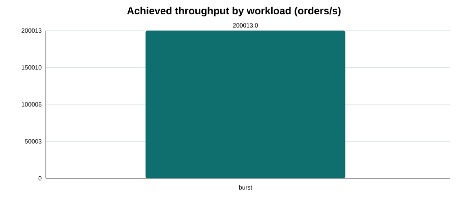

# Workload results: comparison

Runs: 1. Baseline `results/raw/` was not read or modified.

| profile | runs | p50 (us) | p95 (us) | p99 (us) | p99.9 (us) | throughput | accepted | rejected | parser invalid | generated invalid | duplicates | trades |
|---|---:|---:|---:|---:|---:|---:|---:|---:|---:|---:|---:|---:|
| burst | 1 | 27981.0 | 126514.0 | 1014696.0 | 2841997.0 | 200013 | 101000 | 0 | 0 | 0 | 0 | 34090 |

## Charts

`invalid` is the server parser count. `generated invalid` and `duplicates` come from the workload manifest; invalid wire records do not enter the book.
