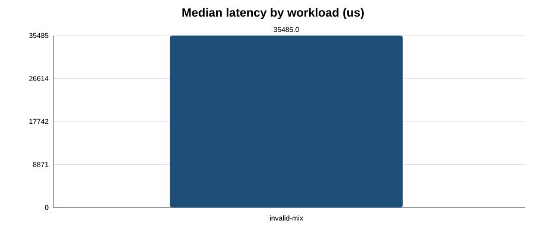
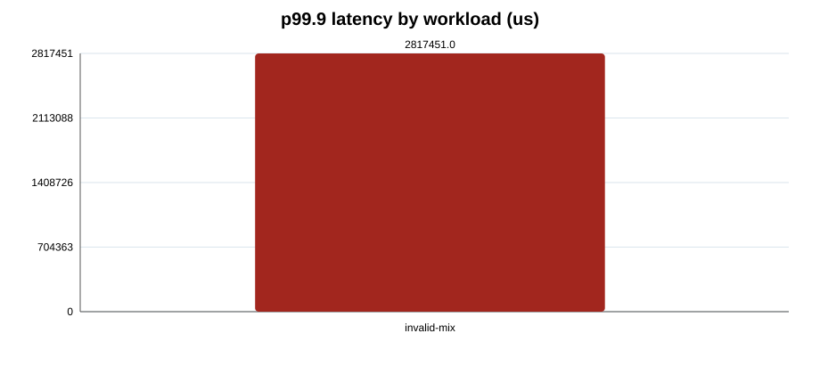

# Workload results: invalid-mix

Runs: 1. Baseline `results/raw/` was not read or modified.

| profile | runs | p50 (us) | p95 (us) | p99 (us) | p99.9 (us) | throughput | accepted | rejected | parser invalid | generated invalid | duplicates | trades |
|---|---:|---:|---:|---:|---:|---:|---:|---:|---:|---:|---:|---:|
| invalid-mix | 1 | 35485.0 | 141227.0 | 289493.0 | 2817451.0 | 197902 | 99396 | 581 | 1023 | 1023 | 985 | 39574 |

## Charts

`invalid` is the server parser count. `generated invalid` and `duplicates` come from the workload manifest; invalid wire records do not enter the book.
