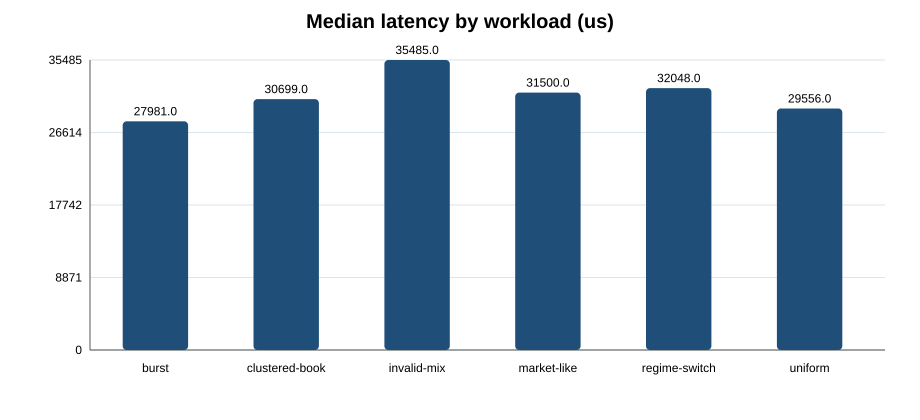
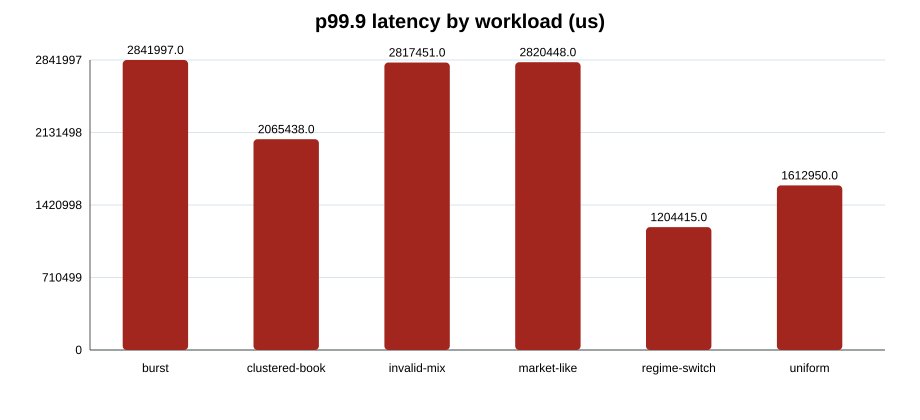
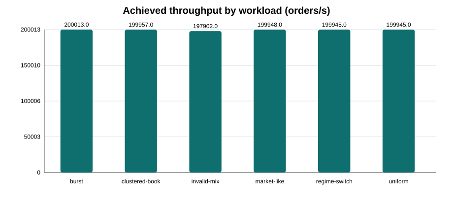

# Workload results: latency-report

Runs: 6. Baseline `results/raw/` was not read or modified.

| profile | runs | p50 (us) | p95 (us) | p99 (us) | p99.9 (us) | throughput | accepted | rejected | parser invalid | generated invalid | duplicates | trades |
|---|---:|---:|---:|---:|---:|---:|---:|---:|---:|---:|---:|---:|
| burst | 1 | 27981.0 | 126514.0 | 1014696.0 | 2841997.0 | 200013 | 101000 | 0 | 0 | 0 | 0 | 34090 |
| clustered-book | 1 | 30699.0 | 149790.0 | 1065381.0 | 2065438.0 | 199957 | 101000 | 0 | 0 | 0 | 0 | 38504 |
| invalid-mix | 1 | 35485.0 | 141227.0 | 289493.0 | 2817451.0 | 197902 | 99396 | 581 | 1023 | 1023 | 985 | 39574 |
| market-like | 1 | 31500.0 | 173322.0 | 973811.0 | 2820448.0 | 199948 | 101000 | 0 | 0 | 0 | 0 | 45177 |
| regime-switch | 1 | 32048.0 | 127428.0 | 254492.0 | 1204415.0 | 199945 | 101000 | 0 | 0 | 0 | 0 | 45177 |
| uniform | 1 | 29556.0 | 175729.0 | 443574.0 | 1612950.0 | 199945 | 101000 | 0 | 0 | 0 | 0 | 44628 |

## Charts

`invalid` is the server parser count. `generated invalid` and `duplicates` come from the workload manifest; invalid wire records do not enter the book.
