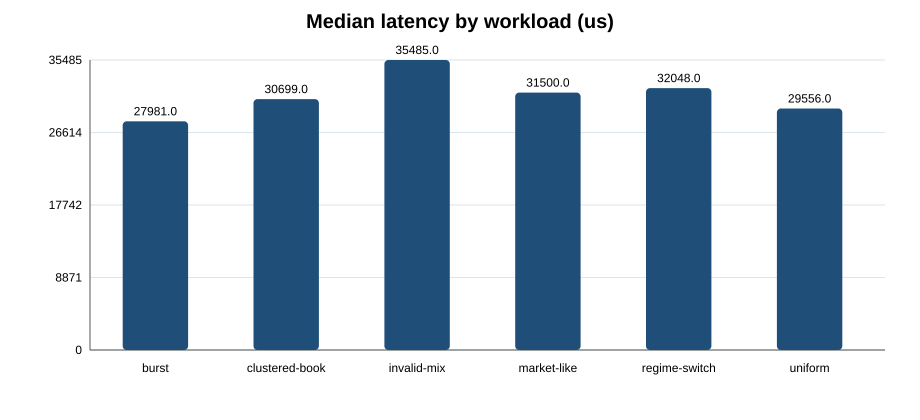
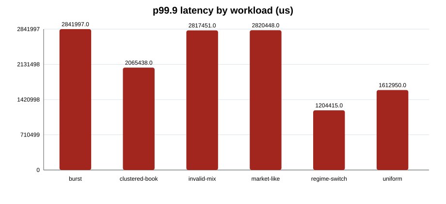
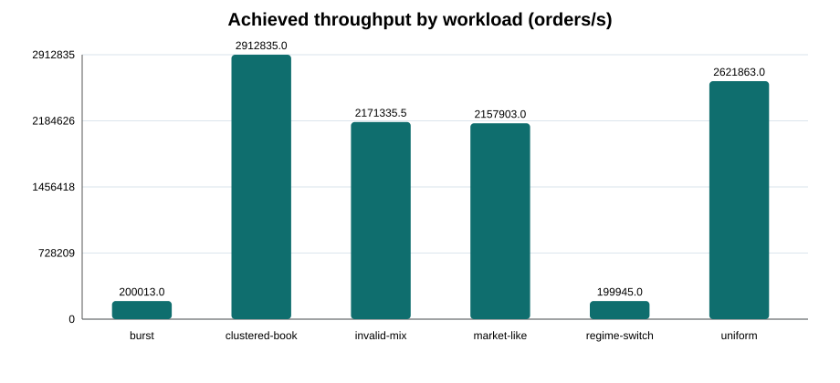

# Workload results: workloads

Runs: 11. Baseline `results/raw/` was not read or modified.

| profile | runs | p50 (us) | p95 (us) | p99 (us) | p99.9 (us) | throughput | accepted | rejected | parser invalid | generated invalid | duplicates | trades |
|---|---:|---:|---:|---:|---:|---:|---:|---:|---:|---:|---:|---:|
| burst | 1 | 27981.0 | 126514.0 | 1014696.0 | 2841997.0 | 200013 | 101000 | 0 | 0 | 0 | 0 | 34090 |
| clustered-book | 2 | 384387.0 | 973397.5 | 1745726.0 | 2329908.5 | 2912835 | 1050500 | 98602 | 0 | 0 | 0 | 391480 |
| invalid-mix | 2 | 387022.5 | 14816159.5 | 17816145.0 | 19554424.0 | 2171336 | 1035018 | 4886 | 10596 | 10596 | 10404 | 666199 |
| market-like | 3 | 1354480.0 | 39603014.0 | 41842333.0 | 43203535.0 | 2157903 | 2000000 | 0 | 0 | 0 | 0 | 1394228 |
| regime-switch | 1 | 32048.0 | 127428.0 | 254492.0 | 1204415.0 | 199945 | 101000 | 0 | 0 | 0 | 0 | 45177 |
| uniform | 2 | 955218.5 | 16388583.0 | 17650126.0 | 18499307.0 | 2621863 | 1050500 | 32270 | 0 | 0 | 0 | 459836 |

## Charts

`invalid` is the server parser count. `generated invalid` and `duplicates` come from the workload manifest; invalid wire records do not enter the book.
