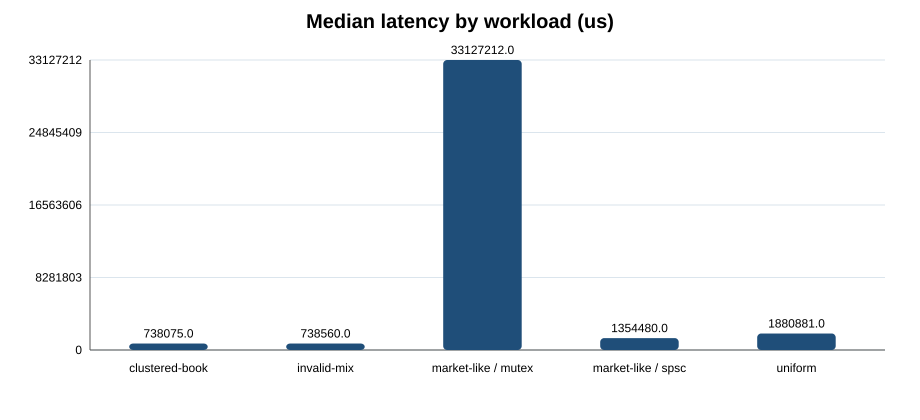
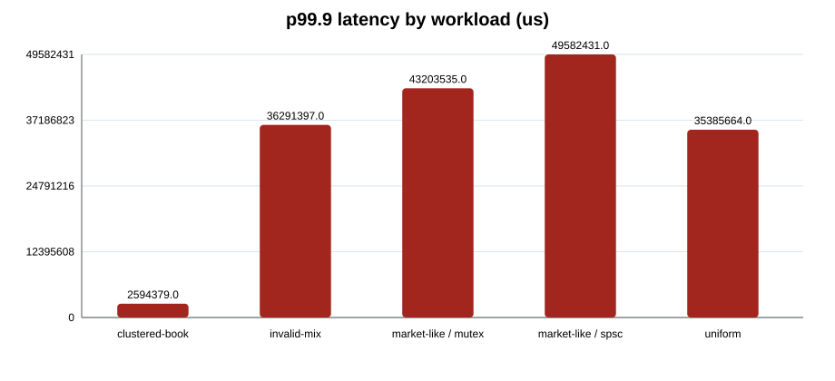

# Workload results: unthrottled-report

Runs: 5. Baseline `results/raw/` was not read or modified.

| profile | runs | p50 (us) | p95 (us) | p99 (us) | p99.9 (us) | throughput | accepted | rejected | parser invalid | generated invalid | duplicates | trades |
|---|---:|---:|---:|---:|---:|---:|---:|---:|---:|---:|---:|---:|
| clustered-book | 1 | 738075.0 | 1797005.0 | 2426071.0 | 2594379.0 | 5625713 | 2000000 | 197203 | 0 | 0 | 0 | 744455 |
| invalid-mix | 1 | 738560.0 | 29491092.0 | 35342797.0 | 36291397.0 | 4144769 | 1970641 | 9190 | 20169 | 20169 | 19822 | 1292824 |
| market-like / mutex | 1 | 33127212.0 | 39603014.0 | 41842333.0 | 43203535.0 | 2157903 | 2000000 | 0 | 0 | 0 | 0 | 1394228 |
| market-like / spsc | 1 | 1354480.0 | 41406753.0 | 48170939.0 | 49582431.0 | 4119194 | 2000000 | 0 | 0 | 0 | 0 | 1394228 |
| uniform | 1 | 1880881.0 | 32601437.0 | 34856678.0 | 35385664.0 | 5043781 | 2000000 | 64540 | 0 | 0 | 0 | 875043 |

## Charts

`invalid` is the server parser count. `generated invalid` and `duplicates` come from the workload manifest; invalid wire records do not enter the book.
